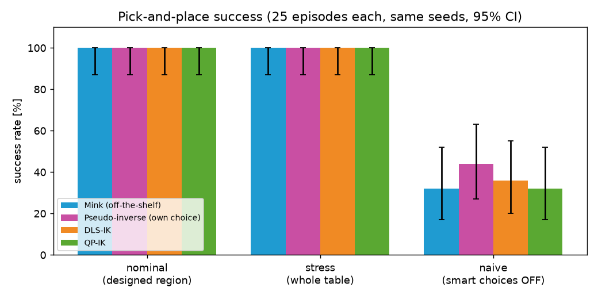
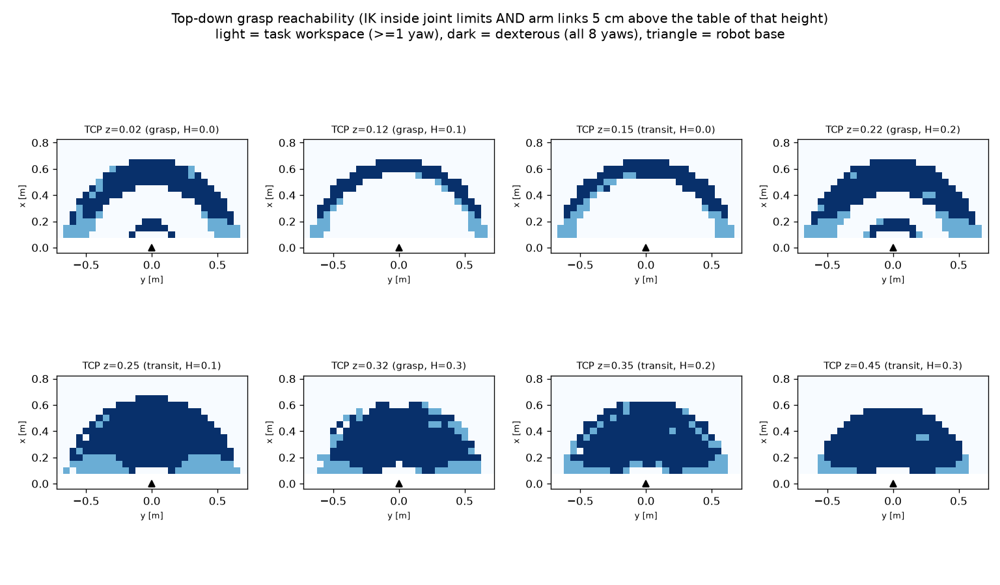
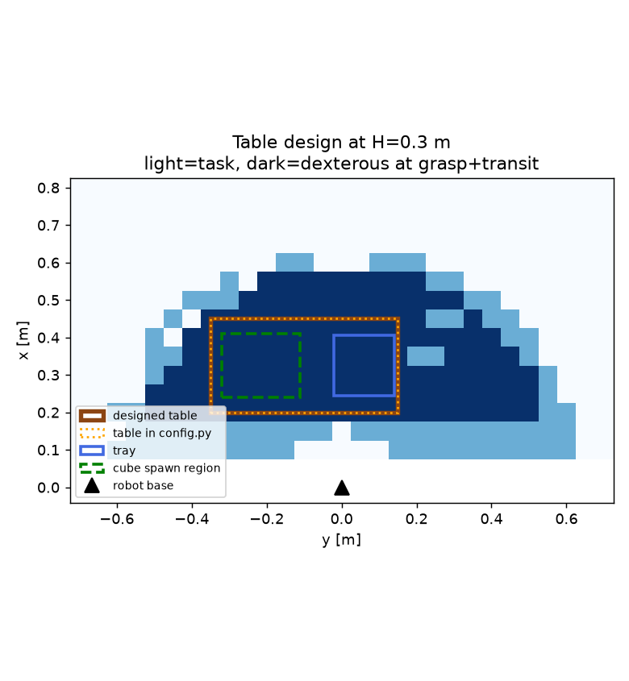
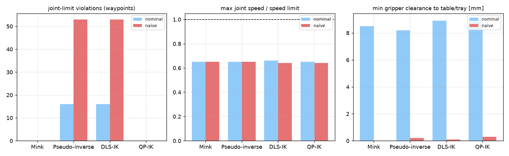
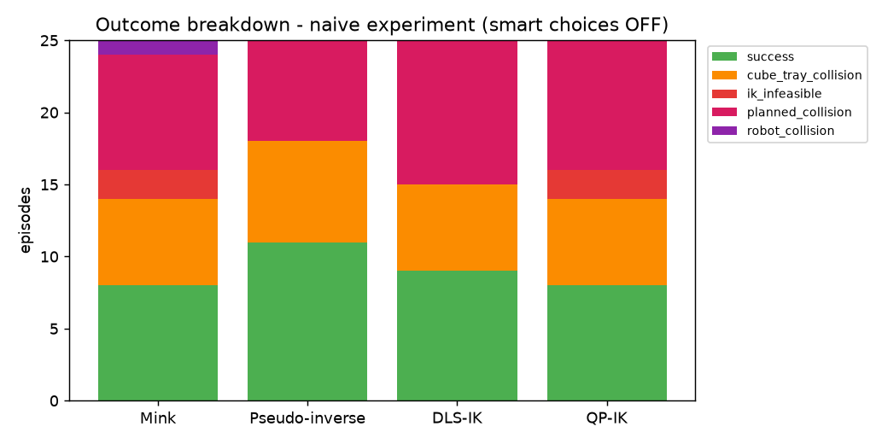

# Pick and Place in MuJoCo with Inverse Kinematics in HEAL

**Course:** Introduction to Robotics (ITR / ME 639), IIT Gandhinagar  
**Tutorial:** Pick and Place of Objects  
**Student:** Prachi Jindal

An **Addverb HEAL** 6-DoF arm (the model from Challenge 2) picks up a 4 cm cube placed
at a random position and rotation on a table and drops it into a tray. The motion is
planned with **inverse kinematics (IK)**, solved four different ways, and all methods
are compared on **exactly the same 25 cube poses**. This is the same task as
[Challenge_3Franka](../Challenge_3Franka/), redone for a non-redundant robot.

| IK method | Type | Where |
|---|---|---|
| **Mink** | off-the-shelf library (Stage 1 baseline) – https://github.com/kevinzakka/mink | `ik_solvers.MinkIK` |
| **Pseudo-inverse** | method of choice: Newton–Raphson, `dq = J⁺ K e` | `ik_solvers.PinvIK` |
| **DLS-IK** | damped least squares, closed loop: `dq = (JᵀJ + λI)⁻¹ Jᵀ K e` | `ik_solvers.DLSIK` |
| **QP-IK** | DLS cost as a quadratic program with joint-limit and joint-velocity constraints (`quadprog`) | `ik_solvers.QPIK` |

🎥 **Video (3 min, 1 min per IK method):** https://youtu.be/-BiwuFK_brM  
---

## 1. Results at a glance

25 episodes per method, seeds 0–24 (identical cube poses for every method).

| Experiment | Mink | Pseudo-inverse | DLS | QP |
|---|---|---|---|---|
| **Nominal** – cube in the designed spawn region | **100 %** | **100 %** | **100 %** | **100 %** |
| **Stress** – cube anywhere on the table | 100 % | 100 % | 100 % | 100 % |
| **Naive** – smart grasp/transit choices switched off | 32 % | 44 % | 36 % | 32 % |
| Planning time per episode (nominal) | 311.6 ms | 18.5 ms | 41.9 ms | 72.9 ms |
| IK iterations per waypoint (nominal) | 16.3 | 2.5 | 5.3 | 13.8 |
| IK answers outside joint limits (nominal / naive) | 0 / 0 | 16 / 53 | 16 / 53 | 0 / 0 |
| Max joint speed / limit (naive) | 0.65 | 0.65 | 0.64 | 0.64 |
| Min. gripper clearance to table/tray (nominal) | 8.5 mm | 8.2 mm | 8.9 mm | 9.0 mm |
| Cube–tray contacts (nominal) | 0 | 0 | 0 | 0 |

Wilson 95 % interval for 25/25: 0.87–1.00.

**Key finding:** with a workspace-based table design and the HEAL planner, every method
succeeds 100 % of the time. The differences show up elsewhere:
* The pseudo-inverse and DLS sometimes return answers **outside the joint limits**. The
  planner rejects these and tries another seed. QP and Mink never do this.
* On a 6-DoF arm the DLS **null-space term is zero**, because there is no spare joint.
* Mink is the slowest here. Started from a seed in the wrong IK branch, it uses all 150
  iterations before giving up. On the Panda the 7th joint hid this.
* Joint speeds stay below the limit for every method (max 0.65 of the limit) because
  the long moves are smooth joint-space transfers.

Full table: [`results/summary.md`](results/summary.md)



---

## 2. What is different from the Franka version

| | Franka Panda | HEAL | Why |
|---|---|---|---|
| Joints | 7 (redundant) | **6** | a pose needs 6 numbers, so there is no spare joint |
| Jacobian | 6×7 | **6×6** (square) | with full rank, J⁺ = J⁻¹ |
| DLS null-space term | keeps joints centred | **zero** | I − J⁺J = 0: no null space on a non-redundant arm |
| Gripper | in the model | **added in `scene.py`** | the HEAL file has no gripper |
| Actuators | position servos | torque motors → **replaced by position servos** | the planner sends joint angles |
| Long moves | straight Cartesian lines | **joint-space transfers** | a 6-DoF arm can't change IK branch part-way along a line |
| IK start | previous waypoint | **seed library** for the grasp and place poses | local IK gets stuck in the wrong branch |
| Workspace | mirrored about y = 0 | **full −y…+y** | link 2 is offset 8.75 cm sideways |
| Table | H 0.10 m, 0.35 × 0.90 m | **H 0.30 m, 0.25 × 0.50 m** | the HEAL can't point down at low heights near its base |
| Tray | −y side | **+y end** | on the −y side, putting the cube down pushed joint 3/4 past ±π |
| Speed limits | Franka datasheet | **2 rad/s assumed** | HEAL joint speeds are not published |

---

## 3. Installation (Windows PowerShell)

```powershell
python -m venv .venv
.venv\Scripts\Activate.ps1
pip install -r requirements.txt
```
* Python 3.11 or 3.12 is recommended.
* If activation is blocked, run `Set-ExecutionPolicy -Scope CurrentUser RemoteSigned` once.
* Linux/macOS: activate with `source .venv/bin/activate`. On a Linux machine without a
  screen, run `export MUJOCO_GL=egl` first.

**Robot model:** `assets/heal/heal.xml` is `single_arm_heal_effort_actuation_rs_mj.xml`
from [`Challenge_2/robot_descriptions`](../Challenge_2/robot_descriptions/). If the
meshes are missing, copy them from Challenge 2:
```powershell
Copy-Item -Recurse ..\Challenge_2\robot_descriptions\heal_meshes assets\heal\heal_meshes
```

---

## 4. How to run

Run every command from this folder with the virtual environment active.

| Step | Command | Time | Output |
|---|---|---|---|
| Test all 4 IK solvers | `python ik_solvers.py` | seconds | 4 × `converged=True` |
| How the home pose was found | `python kinematics.py` | seconds | home pose + singular values |
| Workspace analysis + table design | `python workspace.py` | 10–25 min | `results/ws_*.png`, `results/table_design.md` |
| Re-plot workspace from saved data | `python workspace.py --reuse` | seconds | same plots |
| Watch pick-and-place live | `python pick_place.py --method mink --episodes 3 --viewer` | ~1 min | MuJoCo window |
| Batch run of one method | `python pick_place.py --method dls --episodes 25` | ~2 min | `results/logs_dls.csv` |
| All methods × all experiments + plots | `python compare.py --run` | 15–30 min | `results/summary.md`, `results/plots/`, `results/failures/` |
| Record a 1-min video | `python pick_place.py --method qp --episodes 8 --seed 300 --tag _video --video videos\heal_qp_1min.mp4 --video-seconds 60` | a few min | `videos/heal_qp_1min.mp4` |

`pick_place.py` options:

| Option | Meaning |
|---|---|
| `--method mink\|pinv\|dls\|qp` | IK solver to use |
| `--episodes N` | number of episodes |
| `--seed S` | episode *i* uses seed *S + i* (default 0) |
| `--region designed\|full` | cube spawn area: the designed region, or anywhere on the table |
| `--naive` | switch off the smart choices (used for the failure study) |
| `--retries K` | how many alternate grasp yaws to try if planning fails (default 3) |
| `--video file.mp4`, `--video-seconds T` | record a video with the gripper trail drawn in |
| `--viewer` | open the live MuJoCo viewer (macOS: run with `mjpython`) |
| `--tag _x` | suffix added to the log file name |

---

## 5. Project structure

```
├── config.py        all parameters (robot names, gripper, table, tray, speeds, IK gains)
├── scene.py         HEAL + position servos + added gripper + table/tray/cube (MjSpec)
├── kinematics.py    FK, 6x6 Jacobian, quaternion orientation error, slerp, SeedLibrary
├── ik_solvers.py    Mink, Pseudo-inverse, DLS and QP behind one .solve() interface
├── workspace.py     task / dexterous workspace analysis and table selection
├── pick_place.py    planner (global IK + joint transfers + Cartesian lines), physics, checks, logs
├── recorder.py      mp4 recording with the TCP trail and text overlay
├── compare.py       runs all experiments, summary table and comparison plots
├── requirements.txt
├── assets/heal/     HEAL model (from Challenge_2)
└── results/         plots, logs, summary tables, failure screenshots
```

---

## 6. Method

### 6.1 Scene
* **Robot:** HEAL, 6 revolute joints (range ±π). The HEAL file drives every joint with a
  torque motor; `scene.py` replaces them with **position servos**: kp = 1500 N·m/rad, the
  file's joint damping of 55, and armature 0.05. Gravity compensation is on for all
  robot bodies.
* **Gripper (added):** a palm box on the flange carries two fingers on slide joints
  (0–4.5 cm each). The fingers are coupled by an equality constraint and driven by one
  position actuator.
* **TCP site:** 7.7 cm from the flange, 1 cm above the finger tips.
* **Collisions:** robot parts collide with the world and the cube, not with each other,
  because the HEAL's convex-hull meshes overlap at the joints.
* **Home pose:** the TCP is at (0.33, 0, 0.50) pointing down. At q = 0 the HEAL flange
  already points down, with the tool yaw at 60.8° because of the 0.51 rad twist built
  into link 5.
* **Simulation:** MuJoCo, 2 ms timestep, implicit-fast integrator.
* **Objects:** a 4 cm, 50 g cube with a free joint, and a 16 × 16 cm tray with 5 cm walls.

### 6.2 Workspace analysis and table design (Sections 5–6)
* **Grid:** a 5 cm grid over x 0.10–0.80 m and the full y −0.70–0.70 m. The HEAL is not
  symmetric, so nothing is mirrored.
* **Heights:** grasp height (H + 0.02) and transit height (H + 0.15) for each
  H ∈ {0, 0.1, 0.2, 0.3} m.
* **Grasp test:** at each point, a top-down grasp is solved at **8 yaw angles** with the
  QP-IK. It starts from the seed library and respects the joint limits.
* **Counting rule:** a point counts only if the IK converges **inside the joint limits**
  and the elbow and wrist links stay at least 5 cm above that table.
* **Task workspace:** at least 1 yaw is reachable. **Dexterous workspace:** all 8 yaws
  are reachable.
* **Table choice:** the largest rectangle (with x ≥ 0.20 m) that is dexterous at *both*
  heights.

| H (m) | dexterous area (m²) | largest rectangle (m²) |
|---|---|---|
| 0.00 | 0.135 | 0.038 |
| 0.10 | 0.110 | 0.028 |
| 0.20 | 0.208 | 0.070 |
| **0.30** | **0.323** | **0.165** |

| Parameter | Symbol | Value | Rationale |
|---|---|---|---|
| Table length | L | 0.25 m (x 0.20 → 0.45) | largest dexterous rectangle along x |
| Table width | W | 0.50 m (y −0.35 → 0.15) | same rectangle along y; off-centre because the HEAL is asymmetric |
| Table height | H | 0.30 m | the HEAL's dexterous area grows with height; 0.30 m gives the largest rectangle (0.165 m²) |
| Tray | – | centre (0.325, 0.06), 16 × 16 cm | +y end: placing and lifting stays inside joint limits for all 4 place yaws |
| Spawn region | – | x 0.24–0.41 m, y −0.32…−0.11 m | inside the dexterous rectangle, ≥ 5 cm from the tray walls |




### 6.3 Episode and planning (Sections 7–9)
**Cube pose:** sampled from a seed:
* x ∈ [0.24, 0.41] m, y ∈ [−0.32, −0.11] m, yaw ∈ [−π, π].

**Motion:**
```
home ⇒ pre-grasp (12 cm above) → grasp → [close] → lift ⇒ above tray → place → [open] → retreat
( → straight Cartesian line, IK every 1 cm / 0.1 rad      ⇒ joint-space transfer )
```

**Global IK for the two key poses (grasp and place).**
* The solver starts from the current configuration and from 6 seeds taken from a library
  of about 7000 random "gripper pointing down" postures.
* Each seed is first adjusted: joint 1 turns to face the target, and joint 6 turns to
  match the yaw.
* Every converged answer is a candidate. The nearest is tried first, and answers within
  0.3 rad of a limit are tried last.
* A candidate is accepted only if the vertical line above it also solves.

**Joint-space transfers** (home ⇒ pre-grasp, lift ⇒ above tray) interpolate the joints
directly, with steps of at most 0.05 rad (half the speed limit). The path is checked so
that the gripper stays clear of the table and tray, and the bottom of the carried cube
stays above the tray rim.

**Collision avoidance between cube, gripper, table and tray:**
* **Grasp yaw from cube symmetry.** A cube can be grasped at 4 yaws (every 90°). The
  planner tries them in order of least wrist rotation and retries with the next one if
  planning fails.
* **Transit height.** The cube bottom stays ≥ 5 cm above the tray rim.
* **Place yaw.** The cube is rotated so its edges are parallel to the tray walls.
* **Planned clearance check.** `mj_geomDistance` measures gripper-to-table/tray distance
  on the planned waypoints.
* **Execution checks.** During the physics run, contacts and clearances are monitored
  every step.

**Execution:** joint waypoints are sent to the position servos at about 0.2 m/s TCP
speed. The grasp uses real friction, so the cube can slip or drop.

### 6.4 IK methods (Section 12)
All custom solvers share one closed loop:

> FK → 6-D pose error `e` (position + quaternion error `qe = qt ⊗ qc⁻¹`, log map) → stop
> if < 1 mm and < 0.01 rad → Jacobian `J` (6×6) → `q ← q + Δq`

Only Δq differs:

| Method | Δq | Strengths | Weaknesses |
|---|---|---|---|
| Mink | QP from a `FrameTask`, a `PostureTask`, and configuration, velocity and collision limits | fast to integrate, collision avoidance | slow when the seed is in the wrong branch |
| Pseudo-inverse | `J⁺ K e` (on the HEAL J⁺ = J⁻¹ away from singularities) | simplest, fastest | unstable near singularities, ignores limits |
| DLS | `(JᵀJ + λI)⁻¹ Jᵀ K e`, λ = 0.01 (the null-space term is zero on 6-DoF) | robust near singularities | ignores limits; λ needs tuning |
| QP | `min ½ΔqᵀHΔq + cᵀΔq`, with `H = 2/Δt²(JᵀJ + λI)`, `c = −(1/Δt)Jᵀẋ_d`, subject to joint and velocity limits | hard constraints | needs a solver; more iterations |

**Note on DLS null space:** J is square, so when it has full rank J⁺J = I and
`(I − J⁺J)α(q_mid − q)` = 0. A non-redundant arm has no free joint motion for a
secondary task. The term only "wakes up" exactly at a singularity.

**Note on matching paths:** all four methods produce the same trajectory for the same
cube. A 6-DoF arm has only a few IK solutions per pose, and every method starts from the
same seeds, so they all converge to the same solution. They differ in iterations, time
and joint-limit handling, not in the path.

### 6.5 Logging and comparison (Sections 10 and 13)
**Logged per episode** (`results/logs_<method>.csv`):
* initial cube pose, success, failure reason
* planning and IK time, IK iterations (mean and maximum per waypoint)
* joint-limit and joint-velocity violations
* minimum clearance to table/tray and between cube and tray
* grasp yaw, place yaw, final cube position

**Comparison:** every method uses the same seeds. Success rates are reported with
Wilson 95 % confidence intervals.



---

## 7. Failure analysis (Section 11)

Failures were produced with the **naive** configuration:
* grasp yaw = cube yaw as-is, with no retries and no place-yaw alignment;
* transit only 6 cm above the table;
* no cube-over-rim check.

Screenshots (64) are in [`results/failures/`](results/failures/).

| Failure | Mink | Pinv | DLS | QP | Cause | Mitigation (implemented) |
|---|---|---|---|---|---|---|
| Planned collision (gripper vs table/tray) | 8 | 7 | 10 | 9 | the low joint-space transfer swings the gripper through the tray | transit height above the rim + path clearance check |
| Cube–tray collision | 6 | 7 | 6 | 6 | carried cube dragged into the tray rim | transit height = rim + cube + 5 cm, vertical descent |
| IK infeasible (joint 5 at limit) | 2 | 0 | 0 | 2 | the raw cube yaw needs too much wrist rotation, and the limits are respected | 4 symmetric grasp yaws with retries |
| Robot collision in physics | 1 | 0 | 0 | 0 | a finger touched a tray wall | as above |
| IK answers outside joint limits | 0 | 53 | 53 | 0 | pinv/DLS have no limit constraints | rejected by the planner; or use QP/Mink |
| All IK from home failed (development) | all | all | all | all | 6-DoF IK branches: a local solver started at home got stuck | seed library + joint-space transfers |
| Mink/QP failed 2/25 placing (development) | Mink | – | – | QP | tray on the −y side: lifting after the place pushed joint 3/4 past ±π | tray moved to the +y end after a feasibility scan |



---

## 8. Video

The 3-minute video has one minute each of **Mink**, **DLS** and **QP-IK**. Each minute
uses a different seed, so different cube poses are shown. Each clip draws the gripper
trail; earlier trials stay visible, faded.

https://youtu.be/-BiwuFK_brM

---

## 9. References
* Mink – Python inverse kinematics based on MuJoCo: https://github.com/kevinzakka/mink
* MuJoCo: https://mujoco.org
* HEAL robot model: Addverb HEAL MJCF from [Challenge_2](../Challenge_2/robot_descriptions/)
* Tutorial 4 notes (D. Das): DLS-IK derivation, QP formulation, quaternion error, null-space objectives
